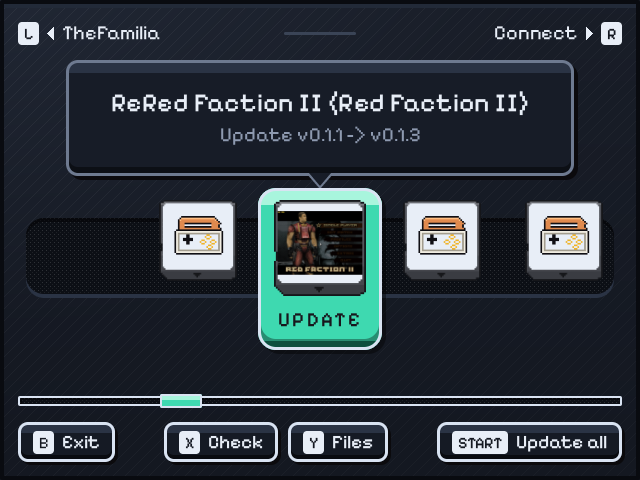

# Slopetanium

An updater for PortMaster ports that are published as GitHub releases, in the spirit of
[Obtainium](https://github.com/ImranR98/Obtainium). It runs on the handheld as a port, with
a console-style home menu on the device and a web interface for your PC, phone or tablet.



- **Watch GitHub repos.** Add, edit and remove repos whose releases carry a PortMaster
  port `.zip` (a zip with `port.json` inside, the usual PortMaster layout).
- **Get told about new releases.** Slopetanium checks GitHub on start and every few hours
  while it runs. Ports with a newer release are marked on the handheld and in the browser.
- **Update, roll back, or install any release.** Installs go through PortMaster's own
  `harbourmaster`, so every CFW PortMaster supports is handled the PortMaster way: ports
  and scripts folders, `gameinfo.xml`, frontend refresh, runtimes and permissions. The last
  versions you installed stay on the device, so a rollback works offline.
- **Your files stay.** An update unpacks over the port folder like PortMaster does.
  Imported game data, settings and saves are kept.
- **Clean up original game files.** Many ports import your own game files from a folder
  such as `source/` on their first run. Afterwards those installers or CD images take a
  lot of space. Slopetanium lists them and deletes the ones you pick, and it tells you
  whether the port seems to have imported them yet.
- **Uninstall** through PortMaster. Optionally, the save and config folders (`conf/` by
  default) are copied to Slopetanium's backups first.
- **Your GOG library.** Sign in to GOG.com once from the web interface. After you install a port
  of a game GOG sells, Slopetanium downloads that game's installer from your library into the
  port's folder, so its first start can import it.
- **A catalogue of ports.** rzrbld's ports are watched from the first start: ReNFS5, The ReThing,
  ReConflict, Vurus, The Familia, ReRed Faction II, and Slopetanium itself.

## Using it

1. Download `slopetanium.zip` from the
   [releases](https://github.com/rzrbld/slopetanium/releases). Put it in
   `PortMaster/autoinstall` and start PortMaster, or unpack it into your ports folder.
2. Start **Slopetanium** from the Ports menu. It shows a shelf with one cartridge per
   watched port and a **Connect** entry. The plate under the selected one says what A does:
   UPDATE, GET, OPEN or SHOW.
   - **Two screens:** when SDL reports two displays, as on the RG DS, the top screen shows
     the selected port in full: its cover, installed / latest / size, and a progress
     meter. While a port's menu is open, it shows that release's notes. The bottom screen
     holds the shelf, and you can tap it.
   - **One screen:** the shelf. A opens the port's page with its menu, and Connect opens
     the QR code page.
3. Open **Connect**. It starts the web interface and shows the address, a QR code that
   includes the PIN, and the 4-digit PIN. Open the address in a browser on the same Wi-Fi,
   then use **Add** to watch a repo: `owner/name` or a github.com link. With nothing watched
   yet, Slopetanium opens Connect by itself.

| Button | Action |
| --- | --- |
| D-pad / stick | Move along the shelf; up/down in menus |
| A | Open: the port's menu (update, roll back, other versions, original files, uninstall), or Connect |
| B | Back / exit |
| X | Check GitHub now |
| Y | Original game files of the selected port |
| L / R | A page of five along the shelf |
| Start | Update all |
| Select+Start | Exit |

Slopetanium will not exit while an install is still running.

### GOG.com

1. In the web interface, open **Settings → GOG.com account → Sign in on GOG.com**. This is
   GOG's own sign-in page, in a new tab.
2. After you sign in you land on an almost empty GOG page. Copy its address (it contains
   `?code=…`), paste it into Slopetanium and press **Link**.

From then on, installing a port whose game is on GOG also fetches the game's Windows installer
from your library. ReRed Faction II's goes into `rered_faction2/source/`, and ReConflict's next
to its binary. This only happens when you own the game and the port has neither the installer
nor imported data yet; turn it off with the checkbox under the account. You can also get the
files any time: use **Get game files from GOG** on the port's card, or in its menu on the
handheld.

- **Only a refresh token is kept,** in `slopetanium/conf/state.json`. Slopetanium never sees
  your password and never shows the token in the web interface.
- **Sign out** removes the token.
- **Downloads resume** if the connection drops.
- **For other ports,** set a GOG game id in a port's **Edit** dialog: the number from the
  game's gog.com product data. Set the folder its files go to, and the installer's file names.

### Per-repo options (web interface)

- **Asset name pattern:** a glob such as `*_aarch64.zip`, for releases with several zips.
  Without a pattern, the zip whose name matches the installed port is used, otherwise
  the first `.zip`.
- **Include pre-releases:** on by default.
- **Originals folder:** where the port wants your game files. The default is `source`.
  Files named `PUT_YOUR_*` and `README*` are never offered for deletion.
- **Back up before uninstall:** folders inside the port to copy away before PortMaster
  removes the port. The default is `conf`.
- **Original files pattern:** for ports that take the game files in their own folder (`.`),
  such as Vurus (`*.iso,*.cue,*.bin`). Only matching files are offered for deletion.

### Settings

- **GitHub token (optional):** without one, GitHub allows 60 checks an hour per IP
  address. Slopetanium uses conditional requests, and an unchanged release list doesn't
  count against that limit.
- **Check interval:** how often to check while Slopetanium runs.
- **Versions kept for offline rollback:** the default is 2.

## How it works

```
Slopetanium.sh ──> app/slopetanium.py --serve   (Python: GitHub, downloads, harbourmaster,
      │              │  API on 127.0.0.1 + token,  web interface on demand, QR codes)
      │              │
      └──────> slopetanium-ui.<arch>             (C++: the menu on one or two screens)
                     ROCKNIXDS Pixel engine + banana-ui's software compositor, shown through SDL2
```

- **The core** (`port/slopetanium/app`) is plain Python 3.7+. It uses the libraries
  PortMaster already ships in `exlibs/`: requests and certifi, qrcode, and pysdl2.
  - It installs with `harbourmaster --no-check install /path/to/port.zip` and uninstalls
    with `harbourmaster uninstall <port>.zip`.
  - It notices ports installed or replaced in PortMaster: version history, cached zips and
    the `md5` that harbourmaster records in `port.json`.
  - A port folder copied in by hand, named like the release zip, counts as installed with
    an unknown version.
  - Everything it keeps lives in `slopetanium/conf/`: `state.json`, the zip cache and
    backups.
- **The menu** (`ui/`) is a small C++ program built on the
  [BananaOS](https://github.com/JorreFog/BananaLinux) launcher engine, under its MIT licence.
  That engine is the ROCKNIXDS Pixel layout and animation engine plus banana-ui's software
  compositor, which redraws only the parts of a screen that changed.
  - Slopetanium shows the result through SDL2 with vsync, one window per display.
  - Pictures are decoded on worker threads; nothing is drawn while nothing changes.
  - It runs at 60 fps on both of the RG DS's panels.
  - Its look is Slopetanium's own: palette, mint accent, slope background and logo.
  - It needs glibc 2.30 or newer, SDL2 and FreeType, all of which PortMaster's own GUI
    needs too.
- **Fallback:** if there is no menu binary for the device's architecture, or it can't
  start, the launch script runs the core's own Python menu instead.
- **The launch script** follows the PortMaster template. It runs PortMaster's shared
  launcher (`utils/pm_launch.txt`) in env-only mode, so Slopetanium gets the same Python,
  SDL and frontend-refresh setup as PortMaster's GUI on that CFW. On BananaOS it switches
  the bottom panel back on.
- **The web interface** listens on port 8686 on your local network and needs the PIN.
  Don't forward that port to the internet.

## Building

```bash
tools/build-ui.sh        # slopetanium-ui.aarch64 in Docker (Debian 11 cross toolchain, glibc 2.30+)
tools/build.sh           # dist/slopetanium.zip (+ .md5): the port, with the menu binary when built
python3 tests/test_core.py   # the core end to end, offline (fake GitHub + fake harbourmaster)
```

To build the menu for your PC, use `make -C ui` (it needs the SDL2 and FreeType headers).
It can draw both screens to PNG without a display:

```bash
SLOP_LOCAL_TOKEN=t python3 port/slopetanium/app/slopetanium.py --serve --root /tmp/slop/ports/slopetanium &
ui/slopetanium-ui --assets port/slopetanium/assets --conf /tmp/slop/ports/slopetanium/conf \
  --token t --screens 2 --shot /tmp/shot --script "right,a"
```

On a device, `slopetanium/conf/dev.env` sets developer switches for the next start:

- `SLOP_FPS=1`: frame statistics in `log.txt`;
- `SLOP_SCRIPT=wait800,right,a`: presses buttons on a timeline;
- `SLOP_SCREENSHOT=/tmp/x`: writes both screens as PNG, then exits;
- `SLOP_SCREENS=1|2`: forces one or two screens.

### CI and releases

GitHub Actions (`.github/workflows/build.yml`) runs on every push and pull request:

1. It runs the tests.
2. It builds the aarch64 menu.
3. It packages `slopetanium.zip` as a workflow artifact.

Pushing a tag `vX.Y.Z` also publishes a GitHub release with `slopetanium.zip` and its
`.md5`. A tag with a suffix, such as `v0.3.0-beta`, makes a pre-release.

## Licence and credits

MIT, see [LICENSE](LICENSE).

- **The menu's engine** comes from [BananaLinux](https://github.com/JorreFog/BananaLinux):
  the ROCKNIXDS Pixel engine and banana-ui's software compositor and JSON reader, all MIT.
  Slopetanium's changes are listed in [ui/third_party/README.md](ui/third_party/README.md).
- **Other third-party pieces:**
  - stb_image and stb_image_write: public domain / MIT;
  - the cartridge shell and the Wi-Fi and battery sprites: from the same engine, MIT;
  - Pixelify Sans in ROCKNIXDS's build: SIL Open Font License 1.1
    (`port/slopetanium/assets/fonts/OFL.txt`).
- **Not used:** no BananaOS artwork, such as the banana mark or the console icons.
